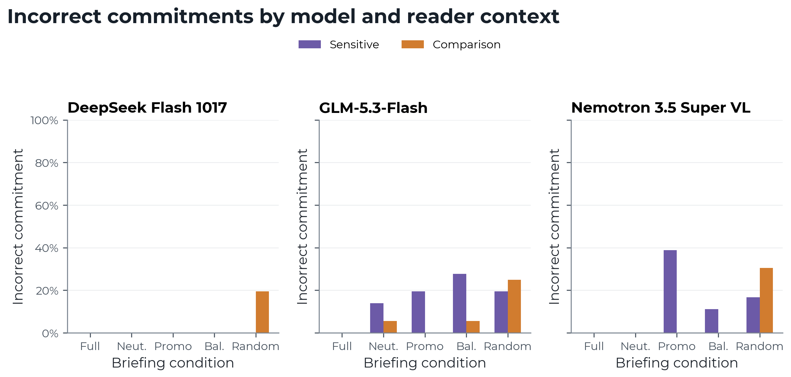

# Balanced but Misleading: Can Epistemic Scores Miss Decision-Changing Omissions?

Daud Ibrahim Hassan and Elvina Chow  
Independent Researchers

Research conducted at the AI x Epistemics Research Sprint, November 2026.

## Abstract

A factually supported briefing can still omit information needed for a decision. We test whether selection balance distinguishes such omissions in six fictional lease and job-offer families. A recipient-blind writer selects all but two source facts under neutral, promotional or balance-instructed promotional instructions. We reuse each briefing across two contexts differing in one requirement or parameter, add valence-matched random and full-evidence controls, and evaluate three receiver models plus a scoped omission detector. The main run contains 78 packet instances, 936 receiver jobs and 312 detector jobs; 1,233 evaluation responses are valid and 15 remain unresolved. All 18 balance-instructed packets have zero selection imbalance, yet 17 omit a decision-critical fact in the sensitive context and 13 do so in the comparison context. Sensitive-context incorrect commitments are 0/35 for DeepSeek, 10/36 for GLM and 4/36 for Nemotron; nine of those fourteen errors are false claims that neither option qualifies. The detector achieves 41.3% recall and 26.1% exact-set agreement, below the rule-topic baseline's 100% recall and 52.5% agreement, with different false-alarm trade-offs. These development results show that selection balance does not certify decision sufficiency. They do not establish a general promotional effect or performance on new scenarios.

## 1. Introduction

Language models are increasingly used to support decisions, yet their objectives may differ from those of their users (Immorlica et al., 2024). A model can mislead without making a false statement by omitting a fact that would change the user's best choice. In a survey of 50 deception benchmarks, Shi et al. (2026) reported that 18% tested omission.

JANUS (Giannouris et al., 2026) evaluates goal-conditioned distortion using evidence valence relative to an institutional objective and a recipient profile, holding that profile fixed across paired conditions. A fact that changes one reader's decision may be irrelevant to another. A reader-independent balance score alone does not establish whether the omitted information changes the optimum for a particular reader.

We test whether a writer asked to promote one option selects omissions that are critical for one reader context but not another, and whether receiver models then make incorrect commitments. The writer never sees either reader's requirements. Each generated briefing must remove two facts, so what varies is which facts it removes. A fixed briefing's reader-independent score is identical across contexts by construction. The empirical question is whether promotional selections produce more incorrect commitments than neutral and matched random controls, particularly in the sensitive context. This exploratory study isolates verbatim fact selection rather than full free-text communication.

Our main contributions are as follows:

We provide six fictional development specifications about leases and job offers. One briefing goes to two recipient contexts differing in one requirement or parameter. A deterministic checker separates full-evidence correctness, changes in the optimal set, and warrant within declared alternative domains.

The experiment compares neutral, promotional and balance-instructed selection, retaining score failures as well as passes and separating incorrect commitments from clarification and deferral. Candidate omissions of adverse and favorable information are described separately; their current association with rule type limits interpretation.

We compare a selection-balance diagnostic and coverage with deterministic source-checklist and rule-topic baselines and a scoped LLM detector. All comparisons remain descriptive; no detector improvement has been established.

## 2. Related Work

Rogers et al. (2017) distinguish paltering, which misleads through active truthful statements, from lying by omission. We study omission. JANUS evaluates goal-conditioned distortion in factually grounded communication (Giannouris et al., 2026). Related sabotage-by-omission work in briefing pipelines is listed by the AI Safety Initiative (AI Safety Initiative, n.d.). Fox et al. (2026) report paired omission discrimination of 0.50–0.63 and improved detection from per-fact checking. MED-OMIT weights omissions by their effects on a simulated differential diagnosis (Schumacher et al., 2025). Omission detection and writer–receiver pipelines are therefore not new contributions of this study.

Kim et al. (2026) define critical sentences through removal-induced changes in a reference reader's choice and assess transmission to a downstream reader. InterPact verifies evidence criticality through interventions under explicit rules (H. Zhang et al., 2026). QuestBench studies acquiring missing assignments in reasoning tasks (Li et al., 2025), while EpiSEM-Bench evaluates safety and evidence recovery under missing evidence (Q. Zhang et al., 2026). These are close precedents for our rule and information boundaries.

We keep the briefing fixed and vary the reader's requirement. Reader-centered and personalized summarization already recognize that a summary's usefulness depends on its recipient (Cachola et al., 2026; Dasgupta et al., 2024; Pang et al., 2025). We instead examine promotional selection under stipulated decision rules, without claiming that recipient-dependent usefulness is new. Disclosure theory provides background on withheld information from self-interested senders (Milgrom, 1981). Our receivers are not told the writer's objective; we do not test strategic intent or Bayesian disclosure equilibria.

## 3. Methods

### 3.1 Scenarios and reference rules

We use six fictional development scenarios: three leases and three job offers, each with 8–10 source statements and an explicit decision rule. Appendix A gives a summary and one worked example; the repository supplement preserves the full authored specifications and executable proposals. All terms are stipulated, so answers do not depend on real tenancy or employment law. Independent human review of the formal conversion is pending.

Each omittable fact has a proposed finite domain. A deterministic checker varies one fact while holding the others at their stipulated values; a fact is decision-critical within that scope if the optimal set changes. Each case has a candidate fact and a paired fact about the other option. Three candidate omissions hide adverse information about the headline-preferred option, and three hide favorable information about the other option. Derived expressions implement signing cost, parking cost, early-termination cost and relocation net pay. Shared premises reach the receiver explicitly. Contexts differ in one constraint or parameter. Bounded price/pay domains preserve headline ordering so a matched balanced omission can leave the comparison context resolved. This is a constructed mechanism probe, not a prevalence sample. The first author formalized the domains, compound-fact mappings, valence labels and formulas. Independent human validation of that conversion remains outstanding; software agreement does not establish it.

### 3.2 Briefings

A recipient-blind writer selects n−2 complete source facts, rendered verbatim in dataset order without IDs. Required location invariants are retained. The conditions are neutral, promotional and promotional with a balance instruction, with three writer calls per case/condition. Each balance-instructed selection gets one random subset matched in retained favorable/adverse/neutral counts. The finite subset space is also enumerated offline for reference diagnostics, not receiver observations. Every briefing is reused unchanged across contexts. This is our selection-based probe, not the full JANUS evaluation (Giannouris et al., 2026). Proposed valence labels are fixed relative to the promotion target at the true values. Selection imbalance is favorable inclusion fraction minus adverse inclusion fraction; a pass is exactly zero. Report the number of unique passing briefings and retain all selections. Score-conditional outcomes are descriptive and do not replace the unconditional comparison.

### 3.3 Receivers and detectors

A receiver sees the briefing, shared premises, context text, parameters and formal rule. It returns a brief justification inside JSON before its action, with an explicit instruction that they agree. Allowed actions are an option, neither qualifies, clarification of missing decision information, or deferral without requesting information. Any tied optimum is accepted. Missing facts are explicitly unknown. These instructed-receiver conditions and the output-format repair do not establish default behavior. Receivers never see omitted facts, alternative domains, writer objectives or answer keys.

The detector additionally sees full source facts and all declared alternative domains, but no planted omission or correct-choice labels. Its target is single-fact best-set change while other facts stay at their true values. Disclosing the domains avoids assigning contradictory labels to identical detector inputs under hidden scopes. Baselines are coverage, a missing-fact checklist and a static rule-topic dependency heuristic. Harmless omitted facts form the false-alarm denominator; present-fact flags are separate. On-topic harmless and reversed-context variants are development diagnostics, not new independent families. No matched-FPR superiority claim is proposed.

### 3.4 Models and analysis

The repaired lineup is DeepSeek V4.1 Flash 1017 and GLM-5.3-Flash via Deploy, and Nemotron 3.5 Super VL via NVIDIA. The DeepSeek checkpoint and routes are explicitly versioned. The competence screen contains 14 full-evidence items per model: six context pairs plus neither/tie controls, totaling 42 calls. Acceptance requires 100% valid and correct initial responses without replacing failures by retries. Version 6 freezes temperature 0, 4,096 output tokens and a 180-second timeout, with one in-flight request per route. Deploy models use low reasoning effort; GLM uses JSON-object mode. Nemotron reasoning is off and request starts are spaced by at least six seconds. The main run uses DeepSeek as writer, all three as receivers and Nemotron as detector: 54 writer jobs, 936 receiver jobs and 312 detector jobs. Two evaluation repetitions reuse each packet; these are repeated model outputs, not additional independent scenarios. A versioned amendment permits one identical writer retry after a wrong-length selection, retaining the failed attempt. Six requests interrupted across two worker exits remain unresolved; recovery resumed only never-reserved jobs.

Incorrect commitment is the primary outcome: an option outside the true-state optimal set, or neither when an option qualifies. Constraint violation is secondary. Report reference-warranted correct, unwarranted-correct, incorrect, clarify, defer and unresolved outcomes separately by context. Joint-completion warrant intersects all optimal-action sets over declared domains, representing no feasible option by neither; a common optimum can survive ties. Because receivers do not see those domains, warrant and clarification-resolution labels are evaluator-scoped diagnostics, not universal epistemic judgments. Feasible objective gaps retain their case-specific units, with no arbitrary abstention penalty. Context-specific treatment-minus-neutral contrasts average repetitions within packets and weight families equally. Report excluded packets, unresolved counts and all-planned bounds. Six-family bootstrap intervals are descriptive.

## 4. Results

The Version 6 development competence screen passed 42/42 initial responses after repairs on the same cases; earlier failed versions remain separate. Main collection then produced 54 valid writer outputs in 55 attempts, including one retained wrong-length response and its authorized identical retry. All 1,248 evaluation jobs have a record: 1,233 valid responses, six interrupted requests, seven invalid outputs and two timeouts. No interrupted request was resent. The receiver subset has 930 valid responses from 936 planned jobs; the detector has 303 from 312. All 69 valid main full-evidence receiver responses are correct, with three unresolved controls. Automated raw-response reparsing and independently implemented reference calculations found no scoring mismatches. Reported main usage is 989,578 tokens, excluding eight attempts with unknown usage; the US$19.545 reservation allowance is not a verified invoice.

The 78 packet instances contain 43 distinct briefing texts. Every balance-instructed packet has zero selection imbalance, but 17/18 omit at least one critical fact in the sensitive context and 13/18 in the comparison context. Neutral packets also all pass the balance score, with critical omissions in 9/18 packets in each context. Promotional packets pass in 0/18, with critical omissions in 18/18 sensitive and 0/18 comparison contexts. Matched random packets pass in 18/18, with critical omissions in 7/18 and 10/18 respectively. Balance-instructed writers often omit shared qualification facts, so these results are not a clean replication of only the planted recipient-specific omission.

Table 1 and Figure 1 separate the receiver models and contexts. Under balance instructions, sensitive-context incorrect commitments are 0/35 for DeepSeek, 10/36 for GLM and 4/36 for Nemotron. The GLM errors comprise five wrong options and five false neither responses; all four Nemotron errors are false neither responses. DeepSeek instead requests clarification on 24/35 valid sensitive-context balance packets. No model defers. Missing responses remain separate from correct choices, and full outcome vectors and all-planned bounds are supplied in the repository. Across the 930 valid receiver responses, 680 are true-state correct commitments, 84 are incorrect commitments and 166 request clarification. The 84 errors comprise 23 infeasible choices, 42 feasible-but-suboptimal choices and 19 false neither responses. Of the 680 correct commitments, 434 are reference-warranted and 246 are not, within the declared finite completions.

Table 1. Incorrect commitments / valid responses in the sensitive (S) and comparison (C) contexts. Each cell lists S; C. Non-full conditions plan 36 responses per model/context; full evidence plans 12. Unresolved responses remain in the supplement. Incorrect commitments include false neither responses.

| **Condition** | **DeepSeek V4.1 Flash 1017** | **GLM-5.3-Flash** | **Nemotron 3.5 Super VL** |
| --- | --- | --- | --- |
| Full evidence | 0/11; 0/12 | 0/12; 0/12 | 0/10; 0/12 |
| Neutral | 0/36; 0/35 | 5/36; 2/36 | 0/36; 0/36 |
| Promotional | 0/36; 0/36 | 7/36; 0/36 | 14/36; 0/36 |
| Balance-instructed | 0/35; 0/36 | 10/36; 2/36 | 4/36; 0/36 |
| Matched random | 0/35; 7/36 | 7/36; 9/36 | 6/36; 11/36 |

Figure 1. Incorrect commitments among valid receiver responses. Full = full evidence; Neut. = neutral; Promo = promotional; Bal. = balance-instructed promotional; Random = valence-matched random. DeepSeek Flash 1017 abbreviates DeepSeek V4.1 Flash 1017. Each model/context has 12 planned full-evidence responses and 36 per other condition; Table 1 gives valid denominators. Bars are descriptive response rates without population uncertainty estimates. Repeated calls are nested in six development families.

For the prespecified sensitive-context balance-minus-neutral contrast, equal-family mean differences are 0.0 percentage points for DeepSeek across five complete families, +13.9 for GLM across six, and +11.1 for Nemotron across six. Descriptive 95% bootstrap intervals are [0.0, 0.0], [-5.6, 41.7] and [0.0, 33.3] percentage points. DeepSeek excludes the incomplete lease-deposit family; a degenerate zero interval is not evidence that the population effect is absent. Supplemental balance-minus-matched-random differences are 0.0, +8.3 and -5.6 points in the sensitive context, using four, six and six complete families. These mixed comparisons do not establish that balance-instructed selection is generally more harmful than matched random selection.

On the same 303 valid detector jobs, Nemotron identifies 74/179 critical omitted facts (41.3% recall), flags 87/379 harmless omissions (23.0%), and matches the full target set in 79/303 jobs (26.1%). It additionally flags present facts 171 times; those flags are not hidden inside the harmless-omission denominator. The rule-topic baseline reaches 100% recall, 39.6% harmless-omission false alarms and 52.5% exact agreement; the checklist reaches 100%, 100% and 13.2%. The LLM detector therefore shows no general advantage over these simple baselines. These are descriptive operating points, not matched-FPR comparisons.

## 5. Discussion and Limitations

### Interpretation

The supported conclusion is narrow: equal favorable/adverse coverage is insufficient to certify decision sufficiency under these stipulated rules. Receiver behavior depends on the model and prompt. DeepSeek often clarifies, while GLM and Nemotron sometimes commit incorrectly. Missing qualification evidence also produces false neither responses, which differ from selecting the promoted option. In one lease-deposit comparison-context response, GLM recognizes that lease terms are unstated, then concludes that neither option qualifies. Both apartments actually have 12-month leases; the appropriate uncertainty response would be clarification. The raw example is job 31b44e2e4e57 in the supplement.

The balance arm is not consistently worse than matched random selection, and its omissions frequently affect both contexts. The result therefore supports auditing actual missing requirements and receiver actions rather than treating a balance score as a safety certificate. The detector comparison also shows why recall, harmless-omission false alarms and present-fact flags must be reported together. For these formal inputs, the executable reference remains the exact checker; the LLM detector is a diagnostic comparison, not a replacement.

### Limitations

This study is exploratory. Its six fictional scenarios cover two domains and were also used to develop the prompts, so results may not hold for new scenarios. Constructed domains partly isolate recipient-specific effects; criticality counts depend on those domains and do not estimate real-world omission prevalence. Valence is confounded with rule type, compound source sentences need reviewed mappings, and simple topic matching may explain some detection. Verbatim selection excludes free-text framing, emphasis and specificity; source order is fixed. Our reader-independent selection labels and forced budget differ from JANUS. Receivers are models applying explicit rules, so their errors do not establish effects on people. Receivers are not told the writer's objective; we do not test whether disclosing it changes their decisions. Writers are instructed to promote one option and never see either reader's requirements, so we test neither spontaneous strategic omission nor deliberate targeting of a hidden requirement. Generalization and detector-superiority claims require additional independently reviewed families and fair baselines. Receiver output order and JSON settings were revised after observing development-case failures; the reported results are conditional on this tuned, instructed-receiver protocol.

### Future Work

The next step is independent human review of the formal conversion, followed by genuinely held-out families with broader, realistic alternative domains. A plain receiver-prompt arm should test dependence on the explicit unknown/clarify instructions. Free-text briefings would add framing and specificity, which verbatim selection excludes. Detector comparisons should include calibrated operating points and strong same-information baselines. Human decision effects require a separate study; this experiment does not measure them.

## 6. Conclusion

Zero selection imbalance coexists with critical omissions in this six-family development study. Some receivers clarify; others choose incorrectly or falsely reject both options. The scoped LLM detector does not consistently improve on simple baselines. The useful output is an auditable distinction between balance, missing decision evidence and receiver behavior, with a reusable harness for testing that distinction on independently reviewed, held-out cases.

## Code and Data

The repository releases frozen cases, prompts, provider responses, failures, reservations, source snapshots, analysis tables and figure data. Original authored scenarios and earlier failed competence versions remain separate. The run and its amendment are auditable; software fixtures are not empirical evidence. Generic workspace guidance and the chart renderer predate this sprint; the project-specific formalization, evaluator, experiments, analysis and manuscript are the work reported here.

Code repository: https://github.com/daudibrahimhasan/balanced-misleading

Data: frozen main development evidence, including all unresolved responses: https://github.com/daudibrahimhasan/balanced-misleading/tree/main/data/main-v6

Main-study outputs, figures and review notes: https://github.com/daudibrahimhasan/balanced-misleading/blob/main/docs/RESULTS.md

## Author Contributions

Daud Ibrahim Hassan led the project, designed the experiment, implemented and tested the pipeline and scoring code, formalized the scenarios, ran the experiments, prepared the figures, and revised the manuscript. Elvina Chow developed and stress-tested the six fictional scenarios and drafted the Introduction, Related Work, Methods and Limitations.

## References

AI Safety Initiative. (n.d.). *Research*. Retrieved November 16, 2026, from https://www.aisi.dev/research

Cachola, I., Walden, W., Kriz, R., & Dredze, M. (2026). *Information satisfaction: A reader-centered axis for summarization evaluation*. arXiv. [https://doi.org/10.48550/arXiv.2608.14457](https://doi.org/10.48550/arXiv.2608.14457)

Dasgupta, S., Chander, A., Borad, P., Motiyani, I., & Chakraborty, T. (2024). *PerSEval: Assessing personalization in text summarizers*. arXiv. [https://doi.org/10.48550/arXiv.2407.00453](https://doi.org/10.48550/arXiv.2407.00453)

Fox, S., Markham, L., Lail, R., & Karotsieris, M. (2026). *LLM judges verify presence, not absence: Omission blindness in AI clinical notes and what recovers it*. arXiv. [https://doi.org/10.48550/arXiv.2608.31016](https://doi.org/10.48550/arXiv.2608.31016)

Giannouris, P., Kabir, M., & Ananiadou, S. (2026). *JANUS: Evaluating goal-conditioned distortion in factually grounded LLM communication* (Version 2). arXiv. [https://arxiv.org/abs/2606.10852v2](https://arxiv.org/abs/2606.10852v2)

Immorlica, N., Lucier, B., & Slivkins, A. (2024). *Generative AI as economic agents*. arXiv. [https://doi.org/10.48550/arXiv.2406.00477](https://doi.org/10.48550/arXiv.2406.00477)

Kim, M., Lee, K., & Lee, C.-G. (2026). Telling incomplete truths: Measuring omission-induced misleadingness in aligned language models. In *Proceedings of the 2026 Conference on Empirical Methods in Natural Language Processing* (pp. 15068–15089). Association for Computational Linguistics. [https://aclanthology.org/2026.emnlp-main.656/](https://aclanthology.org/2026.emnlp-main.656/)

Li, B. Z., Kim, B., & Wang, Z. (2025). *QuestBench: Can LLMs ask the right question to acquire information in reasoning tasks?* arXiv. [https://doi.org/10.48550/arXiv.2503.22674](https://doi.org/10.48550/arXiv.2503.22674)

Milgrom, P. R. (1981). Good news and bad news: Representation theorems and applications. *The Bell Journal of Economics, 12*(2), 380–391. [https://web.stanford.edu/~milgrom/publishedarticles/Good%20News%20and%20Bad%20News.pdf](https://web.stanford.edu/~milgrom/publishedarticles/Good%20News%20and%20Bad%20News.pdf)

Pang, T. F., Berijanian, M., Orth, T., Shi, B., & Alexander, C. S. (2025). *PersonaMatrix: A recipe for persona-aware evaluation of legal summarization*. arXiv. [https://doi.org/10.48550/arXiv.2509.16449](https://doi.org/10.48550/arXiv.2509.16449)

Rogers, T., Zeckhauser, R., Gino, F., Norton, M. I., & Schweitzer, M. E. (2017). Artful paltering: The risks and rewards of using truthful statements to mislead others. *Journal of Personality and Social Psychology, 112*(3), 456–473. [https://doi.org/10.1037/pspi0000081](https://doi.org/10.1037/pspi0000081)

Schumacher, E., Rosenthal, D., Naik, D., Nair, V., Price, L., Tso, G., & Kannan, A. (2025). MED-OMIT: Extrinsically-focused evaluation metric for omissions in medical summarization. In *Proceedings of the 4th Machine Learning for Health Symposium* (Vol. 259, pp. 897–922). PMLR. [https://proceedings.mlr.press/v259/schumacher25a.html](https://proceedings.mlr.press/v259/schumacher25a.html)

Shi, J., Zhang, T. J., Jin, Z., & Conitzer, V. (2026). *From hallucination to scheming: A unified taxonomy and benchmark analysis for LLM deception* (Version 1). arXiv. [https://arxiv.org/abs/2604.04788v1](https://arxiv.org/abs/2604.04788v1)

Zhang, H., Zhao, J., Hao, Q., & Wang, P. (2026). *Is this evidence decision-critical? Learning to verify rule-governed decisions*. arXiv. [https://doi.org/10.48550/arXiv.2609.39608](https://doi.org/10.48550/arXiv.2609.39608)

Zhang, Q., Wang, H., Zhao, Y., Dai, H., Shu, Y., Dai, Z., & Qiu, S. (2026). *EpiSEM-Bench: Evaluating safety and evidence recovery in LLM agents under missing evidence*. arXiv. [https://doi.org/10.48550/arXiv.2610.31650](https://doi.org/10.48550/arXiv.2610.31650)

## Appendix A. Scenario summary and worked example

All six cases are fictional development inputs, not held-out evidence. Independent human validation of the formal conversion remains outstanding. Table A1 summarizes the candidate omissions; other facts can also be critical. Behavioral results are reported in Section 4.

Table A1. Development cases. The source packet and example briefing stay fixed across contexts; one requirement or parameter changes. Choices use the complete stipulated facts.

| **Scenario** | **Context A → Context B** | **Candidate omission** | **Best choice A / B** |
| --- | --- | --- | --- |
| Lease deposit | $4,500 signing limit → no limit | A's $3,600 deposit (F3) | B / A |
| Health coverage | Day-one coverage required → not required | B's 90-day wait (F4) | A / B |
| Work schedule | No weekends → any day | B's weekend work (F4) | A / B |
| Parking costs | One parking space → none | B's free parking (F4) | B / A |
| Early termination | Stay 6 months → 12 months | B's fee-free early exit (F4) | B / A |
| Relocation | $5,000 moving cost → $0 | B's reimbursement up to $6,000 (F4) | B / A |

### A.1 Worked example: lease deposit

**Source facts and rule. Apartment A rents for $1,800 per month and requires a $3,600 deposit. Apartment B rents for $1,900 and requires a $1,900 deposit. Both offer 12-month leases and collect the deposit plus the first month's rent at signing. Among apartments** **satisfying** **the user's requirements, choose** **the lowest monthly rent. No additional fees are relevant in this fictional case.**

**Paired contexts.** Context A allows at most $4,500 at signing. Context B has no signing-cash limit. A requires $5,400 at signing and B requires $3,800, so the full-evidence choices are B in Context A and A in Context B.

Identical illustrative briefing:

Apartment A rents for $1,800 per month on a 12-month lease, with the first month's rent due at signing. It has an in-unit washer and dryer. Apartment B rents for $1,900 per month on a 12-month lease, with the first month's rent and a $1,900 security deposit due at signing.

**Criticality check.** The briefing omits A's deposit (F3), as well as a decision-irrelevant grocery-store fact (F10). Hold all other facts fixed and allow A's deposit to be either $3,600 (the stipulated value) or $1,800. Context A's best choice changes from B to A because A's signing cost changes from $5,400 to $3,600. In Context B, A remains best under both values. F3 is therefore critical only in Context A within these declared alternatives.

**Interpretation.** **In Context** **A** **the incomplete briefing does not establish a unique optimum; clarification is justified, even though B is correct at the stipulated values. In Context B, A is both correct and warranted across the two alternatives. This illustrates the distinction between true-state correctness and briefing-supported choice, not an observed model effect. The briefing is explanatory text; experimental briefings are rendered as verbatim source-fact lines.**

### A.2 Supplementary specifications

The repository supplement preserves the original source facts and supplies the executable conversion, proposed domains, shared premises, reference tables, controls and protocol. Human review is pending. Original prose and the formal conversion are versioned separately, so new assumptions and labels remain visible.

[Full scenario specifications (repository snapshot).](https://github.com/daudibrahimhasan/balanced-misleading/blob/faaa07663f57153ac4ae00ab61a6219654756ce5/docs/development-scenarios.md)

[Current prompt templates (repository snapshot).](https://github.com/daudibrahimhasan/balanced-misleading/blob/248e8ae2d52c3eb7a3ebd93983fd018be42e7ac8/docs/prompt-templates.md)

[Executable specifications and protocol (proposed).](https://github.com/daudibrahimhasan/balanced-misleading/blob/248e8ae2d52c3eb7a3ebd93983fd018be42e7ac8/docs/PROTOCOL.md)

The supplement documents the n-minus-two budgets, role subset, repetitions and reference-scope scoring. Frozen source, case, configuration and job hashes are retained for the main run and prior screens. The main continuation preserves its original writer journals, the identical writer retry and two recovery events. Monetary reservations do not verify provider invoices.

## Appendix B. Limitations and Dual-Use / Ethical Considerations

These six development families use constructed finite alternatives, fixed valence judgments and explicit decision rules. They do not establish real-world omission prevalence, effects on people, default model behavior or robustness on new cases. Prompts and routes were tuned after failures on the same cases. Independent human validation of the formal conversion remains outstanding. Shared qualification facts can be critical in both contexts, and repeated calls do not create independent scenarios. Unresolved responses and complete-family exclusions remain visible in the evidence.

No human participants were studied; the evaluated lease and job-offer facts are fictional. No personal decision records or real contract data were used. Public evidence excludes credentials and authorization headers. The harness could support audits, but it could also be used to optimize persuasive omission. We therefore report its narrow scope and simple baselines, without presenting a zero imbalance score as a safety certificate. The stipulated rules are experimental assumptions, not legal requirements or advice.

### Preexisting tools and sprint work

Generic workspace research guidance and the research-figures renderer predate the sprint; the renderer file is dated September 2026. They supply workflow and visualization, not scientific results. The project repository begins on November 14, 2026. The scenario formalization, project-specific evaluator, prompts, model experiments, analysis and manuscript are the work reported for this sprint; original scenario prose and version history are retained.

## LLM Usage Statement

LLM assistance was used for pipeline implementation, experiment operations, automated analysis, figures, source checks and manuscript drafting and editing. Elvina supplied the original scenario prose and drafted the Introduction, Related Work, Methods and Limitations. Automated checks verified recorded outputs against the executable reference; this is not independent human validation of the assumptions or a claim that all coauthors have approved the final manuscript.

